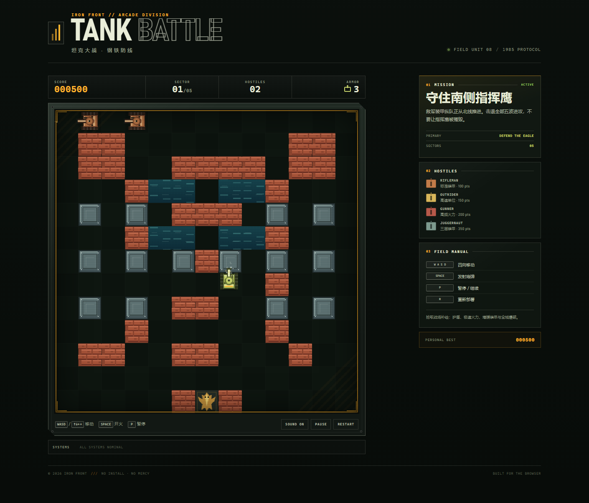

# TANK BATTLE · 坦克大战

一款纯前端、零依赖的复古街机坦克游戏。驾驶装甲单位穿过砖墙与钢堡，在五波敌军进攻中守住南侧指挥鹰。

打开 `index.html` 即可游玩，无需安装、构建或联网。



## 特性

- **完整战斗循环**：五波敌军、动态增援、击杀计分、最高分本地保存。
- **四种敌军单位**：标准步枪兵、高速骑兵、速射炮手与三层装甲的 Juggernaut。
- **可破坏战场**：砖墙逐格击毁，钢板无法穿透，水域阻断履带但允许炮弹飞越。
- **敌军 AI**：基于网格权重的寻路会主动轰开砖墙，并攻击玩家与指挥鹰。
- **战场补给**：护盾、极速火力、额外装甲与全域空袭。
- **街机操作感**：键盘四向移动与射击、暂停/重开、Web Audio 合成音效、震动反馈、粒子爆炸与扫描线 CRT 效果。
- **移动端适配**：响应式布局与触屏方向键/开火按钮。
- **无外部资源**：所有像素画面由 Canvas 绘制，音效由 Web Audio 实时合成。

## 开始游戏

直接双击 `index.html`，或用任意静态文件服务器打开：

```bash
# 任选一种
npx serve .
python -m http.server 8080
```

如果使用本地服务器，请访问 `http://localhost:8080`。

## 操作

| 按键 | 动作 |
| --- | --- |
| `W` `A` `S` `D` / 方向键 | 四向移动 |
| `Space` | 开火（可按住连射） |
| `P` / `Esc` | 暂停 / 继续 |
| `R` | 重新部署 |
| `M` | 静音切换 |

触屏设备可使用画面下方的方向键和 `FIRE` 按钮。

## 规则

- 守住右下方的**金色指挥鹰**。指挥鹰被摧毁即任务失败。
- 玩家共有 3 点装甲；被击中损失 1 点，装甲耗尽即任务失败。
- 击退全部 5 波敌军即可完成任务。每波结束会获得额外分数。
- 砖墙可以被任意炮弹击毁；钢墙会弹开炮弹；水面无法通行。
- 玩家炮弹可拦截敌方炮弹，也会误伤指挥鹰。

### 敌军图鉴

| 单位 | 特点 | 分值 |
| --- | --- | --- |
| RIFLEMAN | 标准速度与火力 | 100 |
| OUTRIDER | 移动速度极快 | 150 |
| GUNNER | 高频射击 | 200 |
| JUGGERNAUT | 三层装甲，需要连续命中 | 350 |

### 战场补给

| 补给 | 效果 |
| --- | --- |
| `SHIELD` | 9 秒护盾，免疫伤害 |
| `RAPID` | 11 秒极速射击，可同时发射更多炮弹 |
| `EXTRA ARMOR` | 增加 1 点装甲 |
| `AIR STRIKE` | 立即摧毁场上所有敌军 |

## 项目结构

```text
tank-battle/
├── index.html          # 页面与界面结构
├── css/
│   └── style.css       # 军械终端风格界面与响应式布局
├── js/
│   └── game.js         # Canvas 渲染、物理、AI、音效与游戏循环
├── assets/
│   ├── favicon.svg     # 站点图标
│   └── preview.png     # README 游戏截图
├── LICENSE
└── README.md
```

## 部署

这是一个纯静态页面，可直接部署到 GitHub Pages、Netlify、Vercel 或任意静态托管服务。

### GitHub Pages

1. 将仓库推送到 GitHub。
2. 打开仓库的 **Settings → Pages**。
3. 在 **Build and deployment** 中选择 **Deploy from a branch**。
4. 选择 `main` 分支和 `/ (root)` 目录，保存后等待发布。

## 浏览器支持

推荐使用最新版 Chrome、Edge、Firefox 或 Safari。游戏需要支持 Canvas 2D 和 ES2020；音效使用 Web Audio API，首次交互后才会启用。

## 开发

游戏代码全部位于 `js/game.js`，按以下模块组织：

- 常量与地图模板
- 音效合成器
- 玩家、敌军与子弹更新
- Dijkstra 网格寻路
- Canvas 绘制
- 输入与游戏主循环

调参入口包括文件顶部的 `WAVES`、`ENEMY_TYPES` 与 `MAP_TEMPLATE`。

## License

[MIT](LICENSE)
